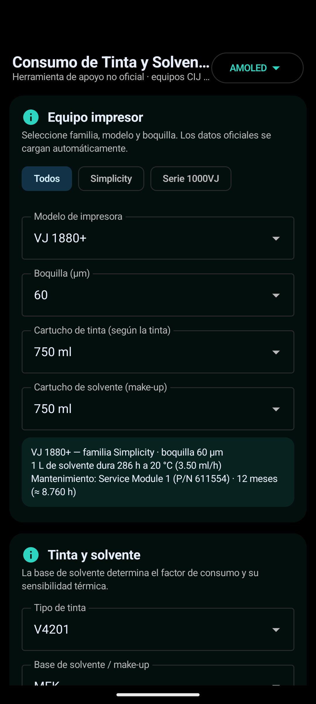

# Consumo CIJ · Calculadora de tinta y solvente

[](https://github.com/emanuelindustri-source/consumo-cij-calculadora/actions/workflows/android.yml)
[](LICENSE)
[](android)
[](#características)
[](web/calculadora-offline.html)

Calculadora técnica de **consumo de tinta y solvente (make-up)** para impresoras de inyección continua
(**CIJ**) **Videojet** de las familias **Simplicity** y **Serie 1000VJ**, basada en los modelos oficiales
de cálculo de Videojet.

Funciona **100 % sin internet**: web autónoma en un solo archivo y aplicación Android nativa sin permisos de red.

<p align="center">
  
</p>

## Contenido del repositorio

| Carpeta | Descripción |
|---|---|
| [`web/`](web) | Calculadora web **offline** en un único archivo HTML (sin dependencias) |
| [`docs/`](docs) | Sitio publicado en GitHub Pages: calculadora + documentación técnica |
| [`android/`](android) | Proyecto Android nativo (Kotlin + Jetpack Compose, Android 14+) |
| [`docs/DATOS.md`](docs/DATOS.md) | Fuentes de datos, fórmulas y validación |
| [`docs/VERSIONES.md`](docs/VERSIONES.md) | Historial detallado de versiones |
| [`ROADMAP.md`](ROADMAP.md) | Próximas mejoras |
| [`CHANGELOG.md`](CHANGELOG.md) | Cambios por versión |

## Enlaces

- **Web (calculadora online):** <https://emanuelindustri-source.github.io/consumo-cij-calculadora/>
- **APK Android:** <https://github.com/emanuelindustri-source/consumo-cij-calculadora/releases/latest>
- **Archivo HTML offline:** [`web/calculadora-offline.html`](web/calculadora-offline.html)

## Características

- **Equipos**: familias **Simplicity** (1240, 1280, 1580, 1580+, 1580C, 1880, 1880+, 1880 UHS, 1880 HR)
  y **Serie 1000VJ** (1040, 1210, 1220, 1510, 1520, 1530, 1550, 1560, 1610, 1610 DH, 1620, 1630, 1650, 1660,
  1620/1650 UHS, 1620/1650 HR, 1710, 1860).
- **Boquillas dependientes del modelo**: 40 µm (HR), 50 µm (UHS), 60 µm, 70 µm. En 1880/1880+ la boquilla
  cambia el consumo real de solvente (60 µm: 286 h/L · 70 µm: 222 h/L a 20 °C).
- **Tintas y bases**: 139 tintas con su base de solvente y **su solvente asociado** (V7201, V7257, V7220…).
- **Cartuchos reales por tinta y modelo**: p. ej. V4225 = 700 ml, V480 = 600 ml, V401 = 750/5000 ml.
- **Mensaje**: tipo de fuente (matriz y líneas), caracteres/línea, líneas, stroke rate, ancho de impresión.
- **Producción**: temperatura, impresiones/min, horas/día, días/semana, días/mes, eficiencia.
- **Validación de velocidad** (CIJ Line Speed Calculator v9.7): velocidad máxima de línea, cpi, dpi,
  ancho mínimo, máximo de caracteres y comprobación de producto/min.
- **Mantenimiento**: módulo de servicio / núcleo con P/N e intervalo del modelo, y cálculo de la fecha
  de cambio según producción.
- **Resultados**: ml/h, ml/día, ml/mes, L/año, duración de cartuchos, relación solvente:tinta vs regla 4:1.
- **Gráficos**: curva de solvente vs temperatura, tinta vs solvente mensual, consumo acumulado de jornada.
- **Exportación**: CSV y TXT mediante el selector de archivos del sistema (sin internet).
- **Historial** local de cálculos y persistencia de la configuración.
- **Temas**: Automático, Claro, Oscuro y **AMOLED (negro puro)** para pantallas OLED/LCD.

## Adaptación de pantalla (Android)

- Teléfonos, phablets, tabletas y TV (1 columna < 840 dp · 2 columnas ≥ 840 dp).
- Cualquier resolución y densidad (mdpi…xxxhdpi); gráficos vectoriales con Canvas.
- Formatos 16:9, 18:9, 20:9, 21:9, 4:3, apaisado, *notch*/cutout y barras de sistema (edge-to-edge).
- Escala de fuente del sistema y multi-ventana.
- Recursos por tamaño: `values/`, `values-sw600dp/`, `values-sw720dp/`, `values-land/`.

## Instalación

### Android (APK)
1. Descargue el APK de la sección **Releases**.
2. Autorice la instalación de aplicaciones de origen desconocido y abra el archivo.
3. Requiere **Android 14 (API 34) o superior**. No solicita permisos de red.

### Web
- **Online**: abra el enlace de GitHub Pages.
- **Offline**: descargue `web/calculadora-offline.html` y ábralo con doble clic
  (Windows, macOS, Linux, Android, iOS). No necesita conexión.

### Compilar la app Android
```bash
cd android
# Requisitos: JDK 17, Android SDK 34, Gradle 8.7+
gradle assembleRelease
```
Consulte [`android/LEEME.md`](android/LEEME.md) para la firma y los detalles.

## Datos y validación

La calculadora implementa exactamente los modelos documentados por Videojet:

| Modelo | Uso |
|---|---|
| **CIJ Makeup Usage Model v14** | Consumo de solvente según temperatura y base química |
| **CIJ TCO Calculator v35** | Gotas por carácter, gotas por litro, contenedores y mantenimiento |
| **CIJ Line Speed Calculator v9.7** | Velocidad de línea, cpi, dpi y límites por matriz |

**Validación con las fuentes oficiales:** 734 fichas de solvente (10–40 °C, horas/L, horas/cartucho)
y 535 fichas de velocidad de línea, con **coincidencia total**. Ver [`docs/DATOS.md`](docs/DATOS.md).

Fórmulas principales:

```
Solvente (ml/h) = (1000 / horas·L⁻¹@20 °C) × factor_base × 0,45143 × e^(k · T) × factor_ajuste
Tinta (ml/impresión) = (gotas/carácter × caracteres × líneas × stroke ÷ gotas/litro) × 1000
Velocidad máx (m/min) = (caracteres/seg ÷ caracteres/línea) × ancho_mm × 0,06
```

## Historial y hoja de ruta

- Historial completo: [`docs/VERSIONES.md`](docs/VERSIONES.md) · [`CHANGELOG.md`](CHANGELOG.md)
- Próximas mejoras: [`ROADMAP.md`](ROADMAP.md)

## Licencia

Software bajo licencia **MIT** (ver [`LICENSE`](LICENSE)). Los datos técnicos provienen de la documentación
de los modelos citados y se ofrecen como **estimación técnica**; contraste los valores con el consumo real
del equipo antes de comprometer pedidos de consumibles.

Proyecto independiente de apoyo técnico, sin afiliación con los fabricantes de los equipos citados.
Las marcas y denominaciones de producto pertenecen a sus respectivos titulares y se citan con fines
descriptivos de compatibilidad.
