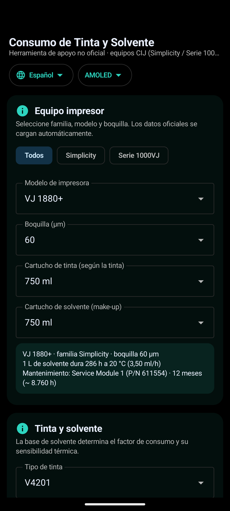

# Consumo CIJ · Calculadora de tinta y solvente

[](https://github.com/emanuelindustri-source/consumo-cij-calculadora/actions/workflows/android.yml)
[](LICENSE)
[](android)
[](#características)
[](web/calculadora-offline.html)

Calculadora técnica de **consumo de tinta y solvente (make-up)** para impresoras de inyección continua
(**CIJ**) **Videojet** de las familias **Simplicity** y **Serie 1000VJ**, basada en los modelos oficiales
de cálculo de Videojet.

Funciona **100 % sin internet** en todo lo esencial: web autónoma en un solo archivo y aplicación
Android nativa cuyos cálculos, informes e historial son locales. La app solo se conecta para
**comprobar si hay una versión nueva** (consulta anónima, opcional y desactivable).

**Versión actual:** **2.5.0** · compilación **11** · 05/11/2026 —
[notas de la versión](docs/NOTAS-2.5.0.md) · [página pública de notas](docs/notas.html) ·
[version.json](version.json)

<p align="center">
  
</p>

## Contenido del repositorio

| Carpeta | Descripción |
|---|---|
| [`web/`](web) | Calculadora web **offline** en un único archivo HTML (sin dependencias) |
| [`docs/`](docs) | Sitio publicado en GitHub Pages: calculadora + documentación técnica |
| [`android/`](android) | Proyecto Android nativo (Kotlin + Jetpack Compose, Android 14+) |
| [`i18n/catalog.json`](i18n/catalog.json) | Catálogo único de traducciones (fuente de verdad de los idiomas) |
| [`tools/`](tools) | Generador de traducciones, validador, pruebas del motor, comprobación de versión y publicación |
| [`docs/DATOS.md`](docs/DATOS.md) | Fuentes de datos, fórmulas y validación |
| [`docs/TINTAS.md`](docs/TINTAS.md) | Validación del catálogo con 493 fichas SDS |
| [`docs/VERSIONES.md`](docs/VERSIONES.md) | Historial detallado de versiones |
| [`docs/notas.html`](docs/notas.html) | Notas públicas: antes / plan / hecho / pendiente y compilaciones |
| [`NOTAS-2.5.0.md`](NOTAS-2.5.0.md) | Notas de la versión actual (raíz y `docs/`, idénticas) |
| [`docs/notas-indice.json`](docs/notas-indice.json) | Registro de notas con su huella SHA-256 (no se pueden borrar) |
| [`version.json`](version.json) | Versión, compilación, fecha y artefactos (legible por máquina) |
| [`ROADMAP.md`](ROADMAP.md) | Próximas mejoras |
| [`CHANGELOG.md`](CHANGELOG.md) | Cambios por versión |

## Notas de versión: permanentes

Las notas de cada versión (`NOTAS-X.Y.Z.md`) son el **historial del proyecto** y **no se borran ni se
reescriben**: son lo que permite a cualquier persona —o a una IA— entender qué es la aplicación, qué
cambió en cada entrega y cuáles son las metas a futuro.

- Cada versión añade la suya, en la raíz y en `docs/`, con los bloques **antes / plan / hecho /
  pendiente**.
- `docs/notas-indice.json` guarda la **huella SHA-256** de las notas publicadas.
- `python tools/check_notas.py` (paso 1 de `python tools/validar.py` y de la CI) **falla** si una nota
  desaparece, si sus dos copias difieren, si una nota congelada se modifica o si a alguna le faltan
  los bloques de contexto. Con `git` disponible, además revisa el historial y denuncia cualquier
  eliminación.

Para una versión nueva: `python tools/check_notas.py --new X.Y.Z`, y al publicar
`python tools/check_notas.py --freeze`.

## Enlaces

- **Web (calculadora online):** <https://emanuelindustri-source.github.io/consumo-cij-calculadora/>
- **APK Android:** <https://github.com/emanuelindustri-source/consumo-cij-calculadora/releases/latest>
- **Archivo HTML offline:** [`web/calculadora-offline.html`](web/calculadora-offline.html)

## Características

- **Equipos**: familias **Simplicity** (1240, 1280, 1580, 1580+, 1580C, 1880, 1880+, 1880 UHS, 1880 HR)
  y **Serie 1000VJ** (1040, 1210, 1220, 1510, 1520, 1530, 1550, 1560, 1610, 1610 DH, 1620, 1630, 1650, 1660,
  1620/1650 UHS, 1620/1650 HR, 1710, 1860).
- **Boquillas dependientes del modelo**: 40 µm (HR), 50 µm (UHS), 60 µm, 70 µm. En 1880/1880+ la boquilla
  cambia el consumo real de solvente (60 µm: 286 h/L · 70 µm: 222 h/L a 20 °C).
- **Tintas y bases**: **139 tintas** con su base de solvente y **su solvente asociado** (V7201, V7257, V7220…).
- **Cartuchos reales por tinta y modelo**: p. ej. V4225 = 700 ml, V480 = 600 ml, V401 = 750/5000 ml.
  Los modelos que el TCO marca como **«750 mL Only»** (1210, 1220, 1240, 1280, 1510 y 1580) solo
  ofrecen **750 ml**, aunque la tinta tenga otros tamaños.
- **Mensaje**: tipo de fuente (matriz y líneas), caracteres/línea, líneas, stroke rate, ancho de impresión.
- **Producción**: temperatura, impresiones/min, horas/día, días/semana, días/mes, eficiencia.
- **Validación de velocidad** (CIJ Line Speed Calculator v9.7): velocidad máxima de línea, cpi, dpi,
  ancho mínimo, máximo de caracteres y comprobación de producto/min.
- **Mantenimiento**: módulo de servicio / núcleo con P/N e intervalo del modelo, y cálculo de la fecha
  de cambio según producción.
- **Resultados**: ml/h, ml/día, ml/mes, L/año, duración de cartuchos, relación solvente:tinta vs regla 4:1.
- **Gráficos**: curva de solvente vs temperatura, tinta vs solvente mensual, consumo acumulado de jornada.
- **Exportación**: CSV y TXT mediante el selector de archivos del sistema (sin internet).
- **Costos para ventas**: moneda (USD, EUR, MXN, COP, BRL, ARS, CLP, PEN, GBP, CNY), precio de cada
  cartucho de tinta y de solvente, costo por hora, día, mes y año, **costo por 1.000 códigos**,
  precio por litro, reparto tinta/solvente y **costo total de propiedad** (equipo + consumibles).
- **Comparador de equipos y competencia**: cálculo actual + hasta **4 escenarios** Videojet o
  manuales (consumo mensual, precio/litro e impresiones/mes), con diferencias, mejor costo
  resaltado y exportación CSV.
- **Historial** local de cálculos y persistencia de la configuración **y de los precios**.
- **Temas**: Automático, Claro, Oscuro y **AMOLED (negro puro)** para pantallas OLED/LCD.
- **Actualizaciones**: aviso dentro de la app, notificación diaria opcional, **novedades por idioma**,
  recordatorio a los 14 días, descarga del APK con verificación **SHA-256** e instalación sobre la
  versión actual.
- **Copia de seguridad**: exportar e importar configuración, historial, tema e idioma en JSON.

## Adaptación de pantalla (Android)

- Teléfonos, phablets, tabletas y TV (1 columna < 840 dp · 2 columnas ≥ 840 dp).
- Cualquier resolución y densidad (mdpi…xxxhdpi); gráficos vectoriales con Canvas.
- Formatos 16:9, 18:9, 20:9, 21:9, 4:3, apaisado, *notch*/cutout y barras de sistema (edge-to-edge).
- Escala de fuente del sistema y multi-ventana.
- Recursos por tamaño: `values/`, `values-sw600dp/`, `values-sw720dp/`, `values-land/`.

## Instalación

### Android (APK)
1. Descargue el APK de la sección **Releases**.
2. Autorice la instalación de aplicaciones de origen desconocido y abra el archivo.
3. Requiere **Android 14 (API 34) o superior**. Los cálculos no necesitan conexión; la app solo
   consulta `version.json` para avisar de una versión nueva, y puede desactivarlo en
   «Actualizaciones».
4. La primera vez, Android pedirá **permitir la instalación de apps desconocidas** para esta app y
   puede mostrar un aviso de **Play Protect**; es el comportamiento normal al instalar fuera de una
   tienda. La actualización se instala encima y conserva los datos.

### Web
- **Online**: abra el enlace de GitHub Pages.
- **Offline**: descargue `web/calculadora-offline.html` y ábralo con doble clic
  (Windows, macOS, Linux, Android, iOS). No necesita conexión.

### Compilar la app Android
```bash
cd android
# Requisitos: JDK 17, Android SDK 34, Gradle 8.7+
gradle assembleRelease
```
Consulte [`android/LEEME.md`](android/LEEME.md) para la firma y los detalles.

### Publicar una actualización (mantenedor)

`version.json` es lo que lee la app para saber si hay una versión nueva. **No se edita a mano**:

```bash
python tools/check_update.py        # coherencia versión · APK · notas · catálogo · red permitida
python tools/release.py --build     # compila, calcula SHA-256 y actualiza version.json
python tools/release.py --publish   # crea la release y sube la APK (GITHUB_TOKEN)
```

La app comprueba al abrirse y una vez al día; al publicar, los usuarios reciben el aviso con la
versión, el tamaño y el botón de instalación. La firma debe ser la misma que la de la versión
instalada para que Android permita actualizar encima.

## Datos y validación

La calculadora implementa exactamente los modelos documentados por Videojet:

| Modelo | Uso |
|---|---|
| **CIJ Makeup Usage Model v14** | Consumo de solvente según temperatura y base química |
| **CIJ TCO Calculator v35** | Gotas por carácter, gotas por litro, contenedores y mantenimiento |
| **CIJ Line Speed Calculator v9.7** | Velocidad de línea, cpi, dpi y límites por matriz |

**Validación con las fuentes oficiales:** **800 fichas de solvente** (12.800 valores de 10–40 °C,
horas/L y horas/cartucho, coincidencia total) y **493 fichas de tintas** (SDS) contrastadas con el
TCO v35. La tabla de velocidad se validó con 535 fichas en la campaña original; su verificador
automático sigue pendiente. Ver [`docs/DATOS.md`](docs/DATOS.md) y [`docs/TINTAS.md`](docs/TINTAS.md).

Fórmulas principales:

```
Solvente (ml/h) = (1000 / horas·L⁻¹@20 °C) × factor_base × 0,45143 × e^(k · T) × factor_ajuste
Tinta (ml/impresión) = (gotas/carácter × caracteres × líneas × stroke ÷ gotas/litro) × 1000
Velocidad máx (m/min) = (caracteres/seg ÷ caracteres/línea) × ancho_mm × 0,06
Costo/hora = (ml/h ÷ ml del cartucho) × precio del cartucho
Costo por 1.000 códigos = (costo/hora ÷ impresiones/hora) × 1000
TCO = (costo/año × años) + precio del equipo
```

## Historial y hoja de ruta

- Historial completo: [`docs/VERSIONES.md`](docs/VERSIONES.md) · [`CHANGELOG.md`](CHANGELOG.md)
- Próximas mejoras: [`ROADMAP.md`](ROADMAP.md)

## Licencia

Software bajo licencia **MIT** (ver [`LICENSE`](LICENSE)). Los datos técnicos provienen de la documentación
de los modelos citados y se ofrecen como **estimación técnica**; contraste los valores con el consumo real
del equipo antes de comprometer pedidos de consumibles.

Proyecto independiente de apoyo técnico, sin afiliación con los fabricantes de los equipos citados.
Las marcas y denominaciones de producto pertenecen a sus respectivos titulares y se citan con fines
descriptivos de compatibilidad.

---

## Idiomas, informes y reporte de errores (2.1.0 – 2.5.0)

- **Español** es el idioma principal; la interfaz se adapta a **inglés, portugués de Brasil,
  portugués de Portugal, italiano y chino simplificado**, con detección automática, selector en la
  web y **selector propio dentro de la app** (con memoria de la elección).
- Catálogo único de traducciones: [`i18n/catalog.json`](i18n/catalog.json) — **554 cadenas × 6
  idiomas**. De ahí se generan el bloque de la web y los `assets/i18n/*.json` de Android
  (`python tools/gen_i18n.py`); las copias nunca se editan a mano.
- **Negrita y formato conservados** en los textos traducidos: los tramos resaltados se marcan con
  `**…**` en el catálogo y la web reconstruye la etiqueta HTML original.
- **Informes traducidos**: las cabeceras y etiquetas de los informes **TXT** y **CSV** y del informe
  técnico se generan en el idioma elegido, con la maquetación alineada automáticamente.
- **Reportar un error**: botón en el pie de la web y tarjeta al final de la app. El informe se abre
  en la aplicación de correo del usuario y se envía a `emanuel.industri@gmail.com`; si no hay
  cliente de correo se puede copiar. **No se añade ningún permiso de red.**
- **Versión y compilación visibles**: la web muestra `v2.5.0 · 05/11/2026` en el pie y la app
  incluye una tarjeta **«Novedades de esta versión»** y `2.5.0 · compilación 11` en las notas técnicas.
- **Seguimiento**: notas completas en [`docs/NOTAS-2.5.0.md`](docs/NOTAS-2.5.0.md),
  [`docs/NOTAS-2.4.1.md`](docs/NOTAS-2.4.1.md) y [`docs/NOTAS-2.1.1.md`](docs/NOTAS-2.1.1.md);
  historial en [`docs/VERSIONES.md`](docs/VERSIONES.md) y [`CHANGELOG.md`](CHANGELOG.md).

## Pruebas y validación

Un solo comando comprueba todo el proyecto:

```bash
python tools/validar.py     # notas · catálogo/web · motor web · motor Kotlin · version.json
```

| Qué | Dónde | Cuántas |
|---|---|---|
| Notas de versión: existencia, copias idénticas, huellas y bloques de contexto | [`tools/check_notas.py`](tools/check_notas.py) | 5 comprobaciones (+ historial de git) |
| Catálogo, copias web, assets, párrafos traducibles, textos de la app, JavaScript y HTML | [`tools/check_i18n.py`](tools/check_i18n.py) | 11 comprobaciones |
| Versión publicada: `version.json`, `build.gradle.kts`, APK, notas y catálogo | [`tools/check_update.py`](tools/check_update.py) | 1 comprobación |
| Motor de cálculo de la web | [`tools/test_engine.js`](tools/test_engine.js) | **64 pruebas** |
| Fichas de solvente (10–40 °C) | [`tools/test_solvent.js`](tools/test_solvent.js) | **12.800 valores (800 fichas)** |
| Fichas de tintas (SDS) | [`tools/check_fichas.py`](tools/check_fichas.py) | **493 PDF · 188 productos** |
| Motor de cálculo de Android | [`android/app/src/test/`](android/app/src/test) | **36 pruebas** |

Las pruebas anclan el motor a los **valores de referencia de los documentos oficiales** (p. ej.
VJ 1880+ / V4201 a 30 °C = 5,21 ml/h, 286 y 222 h/L a 20 °C, 13/19/61 gotas por carácter, núcleo de
14 000 h en los modelos HR), de modo que web y app nunca se separan de las fichas de Videojet.

La **CI** (`.github/workflows/`) ejecuta la validación y las pruebas en cada push: `validar.yml`
para notas, web, idiomas, versión publicada y motor, y `android.yml` para las pruebas de Kotlin,
la compilación de la APK y la comprobación de la red permitida.
